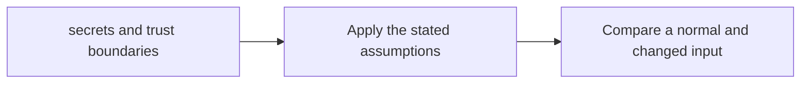

# A15.05 · secrets and trust boundaries

[A15.04](A15.04.md) · Foundation · [A15.06](A15.06.md)

## Problem

An application logs the credential it needs to connect.

## Mechanism

Constrain retrieval to the workload identity, keep secret material out of inputs and logs, scope it to the target operation, and rotate versions with bounded overlap.



## Worked example

Only version 3 remains accepted after rotation; version 2 must fail.

Read the [executable calculation](../examples/A15.05.py) after predicting both outcomes.

```sh
uv run --locked python "01-architecture-A01-to-A20/A15-security-privacy-global-scale/examples/A15.05.py"
uv run --locked python "01-architecture-A01-to-A20/A15-security-privacy-global-scale/examples/A15.05.py" --break
```

Expected outputs are `False` and `True` respectively. Record the changed input, formula or invariant and restore the original control.

## Check your reasoning

1. What assumption is violated in the opening problem?
2. Compute the first result without running the file.
3. Identify the first observable difference in the alternate run.
4. State one change to the input that would exercise the boundary more sharply.
5. How do you observe rotation without disclosing a secret?

<details>
<summary>Feedback</summary>

Compare the opening failure with the mechanism above. The observed results are `False` and `True`. Check the derivation against the worked example. For your additional boundary case, write the expected behavior before executing it. For the transfer question, name the policy, invariant or measurable assumption the decision depends on and identify evidence that would falsify it.

</details>

Compare the first decisive intermediate observation before changing the fixture. Use [L1](../labs/L1.md) for phase-level practice.

## Primary source

- [Reference for secrets and trust boundaries](https://cheatsheetseries.owasp.org/cheatsheets/Authorization_Cheat_Sheet.html)
