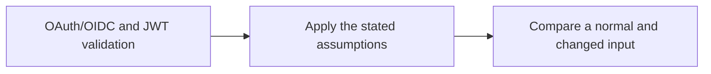

# A15.06 · OAuth/OIDC and JWT validation

[A15.05](A15.05.md) · Core · [A15.07](A15.07.md)

## Problem

A correctly signed JWT was issued to another API.

## Mechanism

Validate the allowed algorithm, issuer, audience and time bounds with keys from trusted issuer metadata. OIDC authenticates a user; resource APIs enforce authorization on appropriate access tokens.



## Worked example

Audience is billing and the endpoint requires catalog. The authorization decision is false despite a valid modeled signature.

Read the [executable calculation](../examples/A15.06.py) after predicting both outcomes.

```sh
uv run --locked python "01-architecture-A01-to-A20/A15-security-privacy-global-scale/examples/A15.06.py"
uv run --locked python "01-architecture-A01-to-A20/A15-security-privacy-global-scale/examples/A15.06.py" --break
```

Expected outputs are `False` and `True` respectively. Record the changed input, formula or invariant and restore the original control.

## Check your reasoning

1. What assumption is violated in the opening problem?
2. Compute the first result without running the file.
3. Identify the first observable difference in the alternate run.
4. State one change to the input that would exercise the boundary more sharply.
5. Why is an ID token usually inappropriate as an API access token?

<details>
<summary>Feedback</summary>

Compare the opening failure with the mechanism above. The observed results are `False` and `True`. Check the derivation against the worked example. For your additional boundary case, write the expected behavior before executing it. For the transfer question, name the policy, invariant or measurable assumption the decision depends on and identify evidence that would falsify it.

</details>

Compare the first decisive intermediate observation before changing the fixture. Use [L1](../labs/L1.md) for phase-level practice.

## Primary source

- [Reference for OAuth/OIDC and JWT validation](https://www.rfc-editor.org/rfc/rfc8725.html)

- [OAuth 2.0 Security Best Current Practice](https://www.rfc-editor.org/rfc/rfc9700.html)
- [OpenID Connect Core 1.0](https://openid.net/specs/openid-connect-core-1_0.html)
