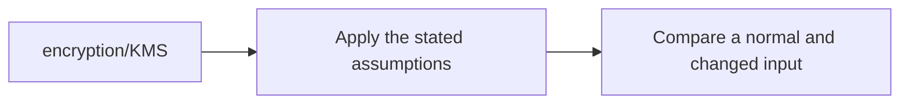

# A15.11 · encryption/KMS

[A15.10](A15.10.md) · Core · [A15.12](A15.12.md)

## Problem

Every object is encrypted directly with a shared long-lived key.

## Mechanism

Envelope encryption uses a data encryption key for data and a managed key to wrap it. Track version and integrity context and restrict decrypt operations.



## Worked example

Two independent data keys wrapped by one key give two data-key identities; direct reuse gives one.

Read the [executable calculation](../examples/A15.11.py) after predicting both outcomes.

```sh
uv run --locked python "01-architecture-A01-to-A20/A15-security-privacy-global-scale/examples/A15.11.py"
uv run --locked python "01-architecture-A01-to-A20/A15-security-privacy-global-scale/examples/A15.11.py" --break
```

Expected outputs are `2` and `1` respectively. Record the changed input, formula or invariant and restore the original control.

## Check your reasoning

1. What assumption is violated in the opening problem?
2. Compute the first result without running the file.
3. Identify the first observable difference in the alternate run.
4. State one change to the input that would exercise the boundary more sharply.
5. What differs between rotating the wrapping key and re-encrypting existing data?

<details>
<summary>Feedback</summary>

Compare the opening failure with the mechanism above. The observed results are `2` and `1`. Check the derivation against the worked example. For your additional boundary case, write the expected behavior before executing it. For the transfer question, name the policy, invariant or measurable assumption the decision depends on and identify evidence that would falsify it.

</details>

Compare the first decisive intermediate observation before changing the fixture. Use [L2](../labs/L2.md) for phase-level practice.

## Primary source

- [Reference for encryption/KMS](https://docs.aws.amazon.com/kms/latest/developerguide/kms-cryptography.html)
