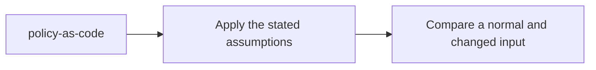

# A15.14 · policy-as-code

[A15.13](A15.13.md) · Core · [A15.15](A15.15.md)

## Problem

Reviewers discover the policy changed after deployment.

## Mechanism

Version policy as data, unit-test permit and deny cases, validate bundle provenance and record the policy version per decision.



## Worked example

One release has both allow and deny evidence. Accept-only tests cover one of two required outcomes.

Read the [executable calculation](../examples/A15.14.py) after predicting both outcomes.

```sh
uv run --locked python "01-architecture-A01-to-A20/A15-security-privacy-global-scale/examples/A15.14.py"
uv run --locked python "01-architecture-A01-to-A20/A15-security-privacy-global-scale/examples/A15.14.py" --break
```

Expected outputs are `2` and `1` respectively. Record the changed input, formula or invariant and restore the original control.

## Check your reasoning

1. What assumption is violated in the opening problem?
2. Compute the first result without running the file.
3. Identify the first observable difference in the alternate run.
4. State one change to the input that would exercise the boundary more sharply.
5. Which controls still apply if the policy engine is temporarily unavailable?

<details>
<summary>Feedback</summary>

Compare the opening failure with the mechanism above. The observed results are `2` and `1`. Check the derivation against the worked example. For your additional boundary case, write the expected behavior before executing it. For the transfer question, name the policy, invariant or measurable assumption the decision depends on and identify evidence that would falsify it.

</details>

Compare the first decisive intermediate observation before changing the fixture. Use [L2](../labs/L2.md) for phase-level practice.

## Primary source

- [Reference for policy-as-code](https://www.openpolicyagent.org/docs/policy-language)
