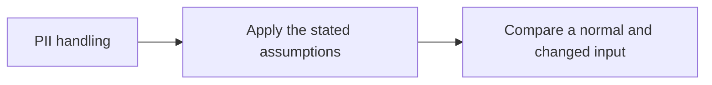

# A15.15 · PII handling

[A15.14](A15.14.md) · Core · [A15.16](A15.16.md)

## Problem

An exported dataset replaces names with stable account tokens.

## Mechanism

Pseudonymised records can remain personal data when attribution is possible using additional information. Limit access and evaluate linkability and attribute inference.



## Worked example

Three records with token T1 permit linkage across three entries even after direct names are removed.

Read the [executable calculation](../examples/A15.15.py) after predicting both outcomes.

```sh
uv run --locked python "01-architecture-A01-to-A20/A15-security-privacy-global-scale/examples/A15.15.py"
uv run --locked python "01-architecture-A01-to-A20/A15-security-privacy-global-scale/examples/A15.15.py" --break
```

Expected outputs are `3` and `0` respectively. Record the changed input, formula or invariant and restore the original control.

## Check your reasoning

1. What assumption is violated in the opening problem?
2. Compute the first result without running the file.
3. Identify the first observable difference in the alternate run.
4. State one change to the input that would exercise the boundary more sharply.
5. Which correlated fields could re-identify the subject?

<details>
<summary>Feedback</summary>

Compare the opening failure with the mechanism above. The observed results are `3` and `0`. Check the derivation against the worked example. For your additional boundary case, write the expected behavior before executing it. For the transfer question, name the policy, invariant or measurable assumption the decision depends on and identify evidence that would falsify it.

</details>

Compare the first decisive intermediate observation before changing the fixture. Use [L2](../labs/L2.md) for phase-level practice.

## Primary source

- [Reference for PII handling](https://eur-lex.europa.eu/eli/reg/2016/679/oj/eng/)
