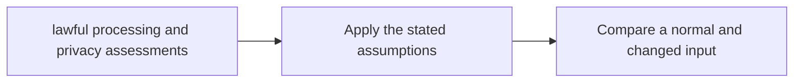

# A15.20 · lawful processing and privacy assessments

[A15.19](A15.19.md) · Principal · [A15.21](A15.21.md)

## Problem

A team treats acceptance of terms as sufficient processing authority.

## Mechanism

Assign and document a lawful basis per purpose. Special-category data can require an additional condition. Assess necessity, proportionality and whether a DPIA is required.



## Worked example

Model two stated purposes and an approval for one. The other is unresolved.

Read the [executable calculation](../examples/A15.20.py) after predicting both outcomes.

```sh
uv run --locked python "01-architecture-A01-to-A20/A15-security-privacy-global-scale/examples/A15.20.py"
uv run --locked python "01-architecture-A01-to-A20/A15-security-privacy-global-scale/examples/A15.20.py" --break
```

Expected outputs are `1` and `0` respectively. Record the changed input, formula or invariant and restore the original control.

## Check your reasoning

1. What assumption is violated in the opening problem?
2. Compute the first result without running the file.
3. Identify the first observable difference in the alternate run.
4. State one change to the input that would exercise the boundary more sharply.
5. Who must confirm the legal basis and update it after a purpose change?

<details>
<summary>Feedback</summary>

Compare the opening failure with the mechanism above. The observed results are `1` and `0`. Check the derivation against the worked example. For your additional boundary case, write the expected behavior before executing it. For the transfer question, name the policy, invariant or measurable assumption the decision depends on and identify evidence that would falsify it.

</details>

Compare the first decisive intermediate observation before changing the fixture. Use [L3](../labs/L3.md) for phase-level practice.

## Primary source

- [Reference for lawful processing and privacy assessments](https://eur-lex.europa.eu/eli/reg/2016/679/oj/eng/)
