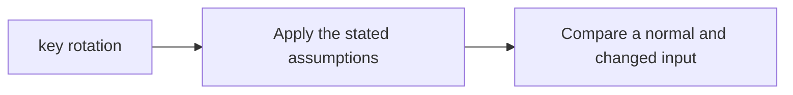

# A15.22 · key rotation

[A15.21](A15.21.md) · Principal · [A15.23](A15.23.md)

## Problem

New writes rotate their key but old ciphertext is unreadable.

## Mechanism

Track key version, phase out old write privileges, retain necessary read rights and verify migration before destruction according to policy.



## Worked example

Reads initially need versions 1 and 2; writes use 2. Destroying 1 leaves one missing read version.

Read the [executable calculation](../examples/A15.22.py) after predicting both outcomes.

```sh
uv run --locked python "01-architecture-A01-to-A20/A15-security-privacy-global-scale/examples/A15.22.py"
uv run --locked python "01-architecture-A01-to-A20/A15-security-privacy-global-scale/examples/A15.22.py" --break
```

Expected outputs are `0` and `1` respectively. Record the changed input, formula or invariant and restore the original control.

## Check your reasoning

1. What assumption is violated in the opening problem?
2. Compute the first result without running the file.
3. Identify the first observable difference in the alternate run.
4. State one change to the input that would exercise the boundary more sharply.
5. When does a compromised key require a different rotation timeline?

<details>
<summary>Feedback</summary>

Compare the opening failure with the mechanism above. The observed results are `0` and `1`. Check the derivation against the worked example. For your additional boundary case, write the expected behavior before executing it. For the transfer question, name the policy, invariant or measurable assumption the decision depends on and identify evidence that would falsify it.

</details>

Compare the first decisive intermediate observation before changing the fixture. Use [L3](../labs/L3.md) for phase-level practice.

## Primary source

- [Reference for key rotation](https://docs.aws.amazon.com/kms/latest/developerguide/kms-cryptography.html)
