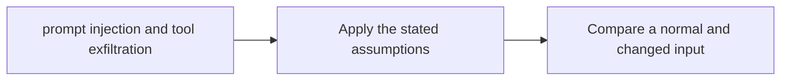

# A15.23 · prompt injection and tool exfiltration

[A15.22](A15.22.md) · Principal · [A15.24](A15.24.md)

## Problem

A model treats text returned by a tool as trusted authority.

## Mechanism

Keep tool output untrusted, validate provenance, and authorize every proposed effect against the caller and destination outside the model. Use a mock data sink for evaluation.



## Worked example

A mock requested write has no grant and must produce zero effects even if its text suggests otherwise.

Read the [executable calculation](../examples/A15.23.py) after predicting both outcomes.

```sh
uv run --locked python "01-architecture-A01-to-A20/A15-security-privacy-global-scale/examples/A15.23.py"
uv run --locked python "01-architecture-A01-to-A20/A15-security-privacy-global-scale/examples/A15.23.py" --break
```

Expected outputs are `0` and `1` respectively. Record the changed input, formula or invariant and restore the original control.

## Check your reasoning

1. What assumption is violated in the opening problem?
2. Compute the first result without running the file.
3. Identify the first observable difference in the alternate run.
4. State one change to the input that would exercise the boundary more sharply.
5. What proof demonstrates the write stayed blocked across retries?

<details>
<summary>Feedback</summary>

Compare the opening failure with the mechanism above. The observed results are `0` and `1`. Check the derivation against the worked example. For your additional boundary case, write the expected behavior before executing it. For the transfer question, name the policy, invariant or measurable assumption the decision depends on and identify evidence that would falsify it.

</details>

Compare the first decisive intermediate observation before changing the fixture. Use [L4](../labs/L4.md) for phase-level practice.

## Primary source

- [Reference for prompt injection and tool exfiltration](https://nvlpubs.nist.gov/nistpubs/AI/NIST.AI.600-1.pdf)
