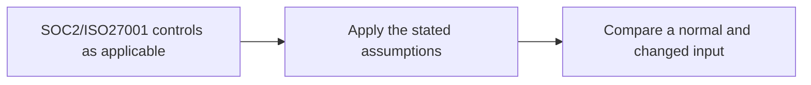

# A15.27 · SOC2/ISO27001 controls as applicable

[A15.26](A15.26.md) · Principal · [A15.28](A15.28.md)

## Problem

A team treats assurance as a single status flag.

## Mechanism

Map actual scope, requirement, control owner and operating evidence. ISO/IEC 27001 specifies an information security management system; SOC 2 is an examination against applicable criteria.



## Worked example

Three controls have named owners, but one of three has current evidence. Evidence coverage is one third.

Read the [executable calculation](../examples/A15.27.py) after predicting both outcomes.

```sh
uv run --locked python "01-architecture-A01-to-A20/A15-security-privacy-global-scale/examples/A15.27.py"
uv run --locked python "01-architecture-A01-to-A20/A15-security-privacy-global-scale/examples/A15.27.py" --break
```

Expected outputs are `0.3333333333333333` and `1.0` respectively. Record the changed input, formula or invariant and restore the original control.

## Check your reasoning

1. What assumption is violated in the opening problem?
2. Compute the first result without running the file.
3. Identify the first observable difference in the alternate run.
4. State one change to the input that would exercise the boundary more sharply.
5. What evidence shows effectiveness across an assessment period?

<details>
<summary>Feedback</summary>

Compare the opening failure with the mechanism above. The observed results are `0.3333333333333333` and `1.0`. Check the derivation against the worked example. For your additional boundary case, write the expected behavior before executing it. For the transfer question, name the policy, invariant or measurable assumption the decision depends on and identify evidence that would falsify it.

</details>

Compare the first decisive intermediate observation before changing the fixture. Use [L4](../labs/L4.md) for phase-level practice.

## Primary source

- [Reference for SOC2/ISO27001 controls as applicable](https://www.iso.org/standard/27001)
