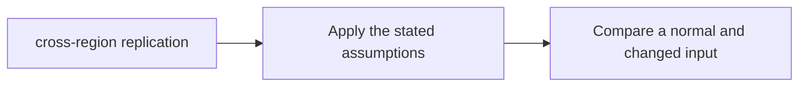

# A15.28 · cross-region replication

[A15.27](A15.27.md) · Principal · [A15.29](A15.29.md)

## Problem

A remote reader serves pre-deletion state during async replication.

## Mechanism

Measure replica freshness and decide which operations tolerate it. Use version, tombstone and reconciliation semantics at failover.



## Worked example

Primary offset 120 and replica 114 imply six entries of lag. A read requiring offset 118 must fail or route elsewhere.

Read the [executable calculation](../examples/A15.28.py) after predicting both outcomes.

```sh
uv run --locked python "01-architecture-A01-to-A20/A15-security-privacy-global-scale/examples/A15.28.py"
uv run --locked python "01-architecture-A01-to-A20/A15-security-privacy-global-scale/examples/A15.28.py" --break
```

Expected outputs are `(6, False)` and `(6, True)` respectively. Record the changed input, formula or invariant and restore the original control.

## Check your reasoning

1. What assumption is violated in the opening problem?
2. Compute the first result without running the file.
3. Identify the first observable difference in the alternate run.
4. State one change to the input that would exercise the boundary more sharply.
5. How do duplicate delivery and tombstone retention affect convergence?

<details>
<summary>Feedback</summary>

Compare the opening failure with the mechanism above. The observed results are `(6, False)` and `(6, True)`. Check the derivation against the worked example. For your additional boundary case, write the expected behavior before executing it. For the transfer question, name the policy, invariant or measurable assumption the decision depends on and identify evidence that would falsify it.

</details>

Compare the first decisive intermediate observation before changing the fixture. Use [L4](../labs/L4.md) for phase-level practice.

## Primary source

- [Reference for cross-region replication](https://docs.aws.amazon.com/whitepapers/latest/disaster-recovery-workloads-on-aws/business-continuity-plan-bcp.html)
