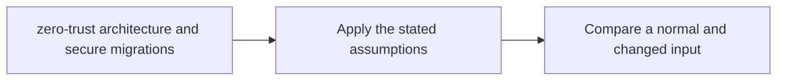

# A15.29 · zero-trust architecture and secure migrations

[A15.28](A15.28.md) · Principal · [Exit gate](../README.md#practice-and-exit-gate)

## Problem

A migration expands privileges to keep both paths working.

## Mechanism

Apply explicit per-request access, least privilege and bounded dual operation. Validate identities for old and new data paths and remove temporary permissions after verification.



## Worked example

Three temporary grants are issued and only two are revoked, so one remains.

Read the [executable calculation](../examples/A15.29.py) after predicting both outcomes.

```sh
uv run --locked python "01-architecture-A01-to-A20/A15-security-privacy-global-scale/examples/A15.29.py"
uv run --locked python "01-architecture-A01-to-A20/A15-security-privacy-global-scale/examples/A15.29.py" --break
```

Expected outputs are `1` and `0` respectively. Record the changed input, formula or invariant and restore the original control.

## Check your reasoning

1. What assumption is violated in the opening problem?
2. Compute the first result without running the file.
3. Identify the first observable difference in the alternate run.
4. State one change to the input that would exercise the boundary more sharply.
5. How would you detect a privilege left over after cutover?

<details>
<summary>Feedback</summary>

Compare the opening failure with the mechanism above. The observed results are `1` and `0`. Check the derivation against the worked example. For your additional boundary case, write the expected behavior before executing it. For the transfer question, name the policy, invariant or measurable assumption the decision depends on and identify evidence that would falsify it.

</details>

Compare the first decisive intermediate observation before changing the fixture. Use [L4](../labs/L4.md) for phase-level practice.

## Primary source

- [Reference for zero-trust architecture and secure migrations](https://csrc.nist.gov/pubs/sp/800/207/final)
