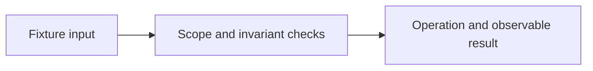

# A15 · Threat model and local policy checks

[Phase index](../../README.md)

Threat model a client, credential verifier and tenant-scoped search boundary. Track uncovered controls and rehearse rotation using dummy secrets.

## Architecture

## Acceptance evidence

- [L1](../../labs/L1.md). Record the uncovered trust flow and propose its control owner.
- [L2](../../labs/L2.md). Record accepted versions and the consequence of leaving overlap enabled.

Run the verification commands from the linked labs. Inspect the [guided source](guided.py) after predicting the outcome.
