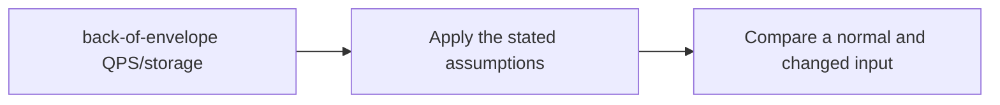

# A16.04 · back-of-envelope QPS/storage

[A16.03](A16.03.md) · Foundation · [A16.05](A16.05.md)

## Problem

Estimated capacity confuses days and seconds.

## Mechanism

Divide daily traffic by 86400 s, estimate high-water traffic separately, and budget storage with retention, replicas and indexes.



## Worked example

8,640,000 requests/day is 100/s average. With factor 4 the peak fixture is 400/s.

Read the [executable calculation](../examples/A16.04.py) after predicting both outcomes.

```sh
uv run --locked python "01-architecture-A01-to-A20/A16-system-design-and-interviews/examples/A16.04.py"
uv run --locked python "01-architecture-A01-to-A20/A16-system-design-and-interviews/examples/A16.04.py" --break
```

Expected outputs are `400` and `100` respectively. Record the changed input, formula or invariant and restore the original control.

## Check your reasoning

1. What assumption is violated in the opening problem?
2. Compute the first result without running the file.
3. Identify the first observable difference in the alternate run.
4. State one change to the input that would exercise the boundary more sharply.
5. Why size write load and read load separately?

<details>
<summary>Feedback</summary>

Compare the opening failure with the mechanism above. The observed results are `400` and `100`. Check the derivation against the worked example. For your additional boundary case, write the expected behavior before executing it. For the transfer question, name the policy, invariant or measurable assumption the decision depends on and identify evidence that would falsify it.

</details>

Compare the first decisive intermediate observation before changing the fixture. Use [L1](../labs/L1.md) for phase-level practice.

## Primary source

- [Reference for back-of-envelope QPS/storage](https://sre.google/workbook/index/)
