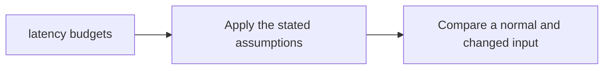

# A16.05 · latency budgets

[A16.04](A16.04.md) · Foundation · [A16.06](A16.06.md)

## Problem

Each team consumes the entire end-to-end budget.

## Mechanism

For a serial critical path, add component durations at the request level. Percentiles generally do not add; correlate per-request traces.



## Worked example

Gateway 12, storage 28 and network 10 ms total 50 ms.

Read the [executable calculation](../examples/A16.05.py) after predicting both outcomes.

```sh
uv run --locked python "01-architecture-A01-to-A20/A16-system-design-and-interviews/examples/A16.05.py"
uv run --locked python "01-architecture-A01-to-A20/A16-system-design-and-interviews/examples/A16.05.py" --break
```

Expected outputs are `50` and `28` respectively. Record the changed input, formula or invariant and restore the original control.

## Check your reasoning

1. What assumption is violated in the opening problem?
2. Compute the first result without running the file.
3. Identify the first observable difference in the alternate run.
4. State one change to the input that would exercise the boundary more sharply.
5. How does two-way fanout change the critical path calculation?

<details>
<summary>Feedback</summary>

Compare the opening failure with the mechanism above. The observed results are `50` and `28`. Check the derivation against the worked example. For your additional boundary case, write the expected behavior before executing it. For the transfer question, name the policy, invariant or measurable assumption the decision depends on and identify evidence that would falsify it.

</details>

Compare the first decisive intermediate observation before changing the fixture. Use [L1](../labs/L1.md) for phase-level practice.

## Primary source

- [Reference for latency budgets](https://sre.google/workbook/index/)
