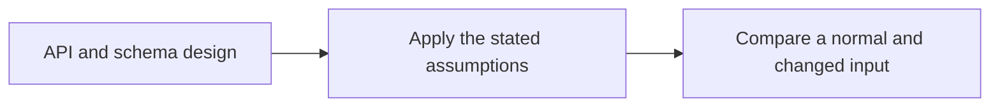

# A16.08 · API and schema design

[A16.07](A16.07.md) · Core · [A16.09](A16.09.md)

## Problem

Retrying a creation API creates duplicate records.

## Mechanism

Define resource identity, constraints, status semantics and version evolution. A scoped idempotency key must bind the request payload and result.



## Worked example

Two retries on same tenant/key yield one stored logical request.

Read the [executable calculation](../examples/A16.08.py) after predicting both outcomes.

```sh
uv run --locked python "01-architecture-A01-to-A20/A16-system-design-and-interviews/examples/A16.08.py"
uv run --locked python "01-architecture-A01-to-A20/A16-system-design-and-interviews/examples/A16.08.py" --break
```

Expected outputs are `1` and `2` respectively. Record the changed input, formula or invariant and restore the original control.

## Check your reasoning

1. What assumption is violated in the opening problem?
2. Compute the first result without running the file.
3. Identify the first observable difference in the alternate run.
4. State one change to the input that would exercise the boundary more sharply.
5. What happens if the retry carries a different payload?

<details>
<summary>Feedback</summary>

Compare the opening failure with the mechanism above. The observed results are `1` and `2`. Check the derivation against the worked example. For your additional boundary case, write the expected behavior before executing it. For the transfer question, name the policy, invariant or measurable assumption the decision depends on and identify evidence that would falsify it.

</details>

Compare the first decisive intermediate observation before changing the fixture. Use [L1](../labs/L1.md) for phase-level practice.

## Primary source

- [Reference for API and schema design](https://www.rfc-editor.org/rfc/rfc9110.html)
