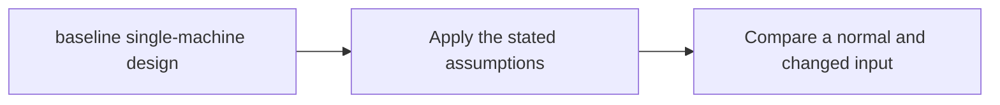

# A16.09 · baseline single-machine design

[A16.08](A16.08.md) · Core · [A16.10](A16.10.md)

## Problem

The design adds sharding before measuring a single node.

## Mechanism

Start with transactional persistence and clear invariants. Measure data size, queue delay and failure modes under representative workload before splitting.



## Worked example

Read 200/s with observed capacity 500/s gives load ratio 0.4.

Read the [executable calculation](../examples/A16.09.py) after predicting both outcomes.

```sh
uv run --locked python "01-architecture-A01-to-A20/A16-system-design-and-interviews/examples/A16.09.py"
uv run --locked python "01-architecture-A01-to-A20/A16-system-design-and-interviews/examples/A16.09.py" --break
```

Expected outputs are `0.4` and `2.5` respectively. Record the changed input, formula or invariant and restore the original control.

## Check your reasoning

1. What assumption is violated in the opening problem?
2. Compute the first result without running the file.
3. Identify the first observable difference in the alternate run.
4. State one change to the input that would exercise the boundary more sharply.
5. What change would justify leaving the single-node baseline?

<details>
<summary>Feedback</summary>

Compare the opening failure with the mechanism above. The observed results are `0.4` and `2.5`. Check the derivation against the worked example. For your additional boundary case, write the expected behavior before executing it. For the transfer question, name the policy, invariant or measurable assumption the decision depends on and identify evidence that would falsify it.

</details>

Compare the first decisive intermediate observation before changing the fixture. Use [L1](../labs/L1.md) for phase-level practice.

## Primary source

- [Reference for baseline single-machine design](https://sqlite.org/isolation.html)
