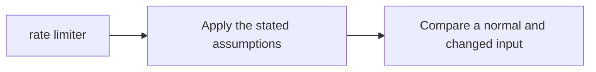

# A16.12 · rate limiter

[A16.11](A16.11.md) · Core · [A16.13](A16.13.md)

## Problem

A local limiter allows four times the global allowance.

## Mechanism

Choose a key, unit, time model and coordination scope. Per-process buckets bound each worker, while a shared bound needs coordination.



## Worked example

Four independent buckets of 10 can collectively accept 40; intended shared cap is 10.

Read the [executable calculation](../examples/A16.12.py) after predicting both outcomes.

```sh
uv run --locked python "01-architecture-A01-to-A20/A16-system-design-and-interviews/examples/A16.12.py"
uv run --locked python "01-architecture-A01-to-A20/A16-system-design-and-interviews/examples/A16.12.py" --break
```

Expected outputs are `10` and `40` respectively. Record the changed input, formula or invariant and restore the original control.

## Check your reasoning

1. What assumption is violated in the opening problem?
2. Compute the first result without running the file.
3. Identify the first observable difference in the alternate run.
4. State one change to the input that would exercise the boundary more sharply.
5. What should the limiter do during coordination failure?

<details>
<summary>Feedback</summary>

Compare the opening failure with the mechanism above. The observed results are `10` and `40`. Check the derivation against the worked example. For your additional boundary case, write the expected behavior before executing it. For the transfer question, name the policy, invariant or measurable assumption the decision depends on and identify evidence that would falsify it.

</details>

Compare the first decisive intermediate observation before changing the fixture. Use [L2](../labs/L2.md) for phase-level practice.

## Primary source

- [Reference for rate limiter](https://sre.google/workbook/index/)
