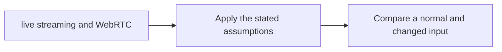

# A16.24 · live streaming and WebRTC

[A16.23](A16.23.md) · Principal · [A16.25](A16.25.md)

## Problem

A room is mistakenly budgeted as a CDN download.

## Mechanism

WebRTC handles interactive real-time media and negotiates network paths and media parameters. Track forwarding and congestion separately from playback delivery.



## Worked example

Five peers in a full mesh give each peer four outgoing streams and 20 directed streams.

Read the [executable calculation](../examples/A16.24.py) after predicting both outcomes.

```sh
uv run --locked python "01-architecture-A01-to-A20/A16-system-design-and-interviews/examples/A16.24.py"
uv run --locked python "01-architecture-A01-to-A20/A16-system-design-and-interviews/examples/A16.24.py" --break
```

Expected outputs are `20` and `5` respectively. Record the changed input, formula or invariant and restore the original control.

## Check your reasoning

1. What assumption is violated in the opening problem?
2. Compute the first result without running the file.
3. Identify the first observable difference in the alternate run.
4. State one change to the input that would exercise the boundary more sharply.
5. When does centralized forwarding change the uplink budget?

<details>
<summary>Feedback</summary>

Compare the opening failure with the mechanism above. The observed results are `20` and `5`. Check the derivation against the worked example. For your additional boundary case, write the expected behavior before executing it. For the transfer question, name the policy, invariant or measurable assumption the decision depends on and identify evidence that would falsify it.

</details>

Compare the first decisive intermediate observation before changing the fixture. Use [L3](../labs/L3.md) for phase-level practice.

## Primary source

- [Reference for live streaming and WebRTC](https://www.rfc-editor.org/rfc/rfc8825.html)
