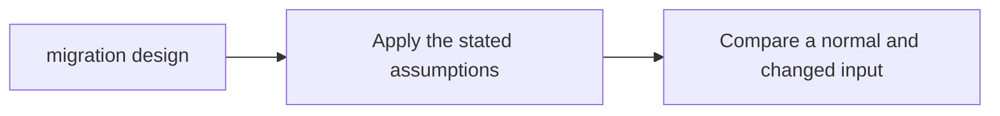

# A16.28 · migration design

[A16.27](A16.27.md) · Principal · [A16.29](A16.29.md)

## Problem

Dual writes diverge before the migration cutover.

## Mechanism

Use a migration contract with backfill, reconciliation, shadow reads, compatibility and rollback bounds. Agree on the source of truth during each state.



## Worked example

Out of 100 paired reads, 98 match. Two discrepancies block a zero-difference gate.

Read the [executable calculation](../examples/A16.28.py) after predicting both outcomes.

```sh
uv run --locked python "01-architecture-A01-to-A20/A16-system-design-and-interviews/examples/A16.28.py"
uv run --locked python "01-architecture-A01-to-A20/A16-system-design-and-interviews/examples/A16.28.py" --break
```

Expected outputs are `2` and `0` respectively. Record the changed input, formula or invariant and restore the original control.

## Check your reasoning

1. What assumption is violated in the opening problem?
2. Compute the first result without running the file.
3. Identify the first observable difference in the alternate run.
4. State one change to the input that would exercise the boundary more sharply.
5. When is rollback unsafe after the new schema has accepted writes?

<details>
<summary>Feedback</summary>

Compare the opening failure with the mechanism above. The observed results are `2` and `0`. Check the derivation against the worked example. For your additional boundary case, write the expected behavior before executing it. For the transfer question, name the policy, invariant or measurable assumption the decision depends on and identify evidence that would falsify it.

</details>

Compare the first decisive intermediate observation before changing the fixture. Use [L4](../labs/L4.md) for phase-level practice.

## Primary source

- [Reference for migration design](https://docs.cloud.google.com/architecture/framework)
