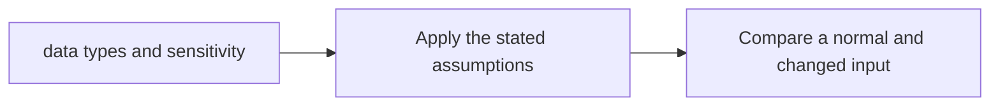

# A17.01 · data types and sensitivity

[Phase index](../README.md) · Foundation · [A17.02](A17.02.md)

## Problem

A telemetry field reveals health status indirectly.

## Mechanism

Identify data subjects, data categories, intended use and sensitivity. GDPR special categories include data concerning health; derived or inferred fields also need assessment.



## Worked example

Three fields include two classified sensitive in the fixture. A direct-identifier-only policy captures one.

Read the [executable calculation](../examples/A17.01.py) after predicting both outcomes.

```sh
uv run --locked python "01-architecture-A01-to-A20/A17-regulated-ai-compliance-governance/examples/A17.01.py"
uv run --locked python "01-architecture-A01-to-A20/A17-regulated-ai-compliance-governance/examples/A17.01.py" --break
```

Expected outputs are `2` and `1` respectively. Record the changed input, formula or invariant and restore the original control.

## Check your reasoning

1. What assumption is violated in the opening problem?
2. Compute the first result without running the file.
3. Identify the first observable difference in the alternate run.
4. State one change to the input that would exercise the boundary more sharply.
5. Which derived labels deserve the same classification as source records?

<details>
<summary>Feedback</summary>

Compare the opening failure with the mechanism above. The observed results are `2` and `1`. Check the derivation against the worked example. For your additional boundary case, write the expected behavior before executing it. For the transfer question, name the policy, invariant or measurable assumption the decision depends on and identify evidence that would falsify it.

</details>

Compare the first decisive intermediate observation before changing the fixture. Use [L1](../labs/L1.md) for phase-level practice.

## Primary source

- [Reference for data types and sensitivity](https://eur-lex.europa.eu/eli/reg/2016/679/oj/eng/)
