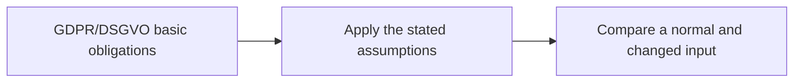

# A17.06 · GDPR/DSGVO basic obligations

[A17.05](A17.05.md) · Core · [A17.07](A17.07.md)

## Problem

A project starts with no purpose or lawful-basis record.

## Mechanism

Map applicable GDPR principles and legal basis, special-category conditions where relevant, rights procedures and accountability evidence. Assess applicability and local law with the responsible team.



## Worked example

Two purposes recorded, only one with legal-basis evidence, leaves one review item.

Read the [executable calculation](../examples/A17.06.py) after predicting both outcomes.

```sh
uv run --locked python "01-architecture-A01-to-A20/A17-regulated-ai-compliance-governance/examples/A17.06.py"
uv run --locked python "01-architecture-A01-to-A20/A17-regulated-ai-compliance-governance/examples/A17.06.py" --break
```

Expected outputs are `1` and `0` respectively. Record the changed input, formula or invariant and restore the original control.

## Check your reasoning

1. What assumption is violated in the opening problem?
2. Compute the first result without running the file.
3. Identify the first observable difference in the alternate run.
4. State one change to the input that would exercise the boundary more sharply.
5. Which parts of a workflow require a data protection assessment?

<details>
<summary>Feedback</summary>

Compare the opening failure with the mechanism above. The observed results are `1` and `0`. Check the derivation against the worked example. For your additional boundary case, write the expected behavior before executing it. For the transfer question, name the policy, invariant or measurable assumption the decision depends on and identify evidence that would falsify it.

</details>

Compare the first decisive intermediate observation before changing the fixture. Use [L1](../labs/L1.md) for phase-level practice.

## Primary source

- [Reference for GDPR/DSGVO basic obligations](https://eur-lex.europa.eu/eli/reg/2016/679/oj/eng/)
