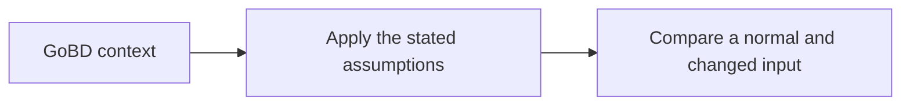

# A17.07 · GoBD context

[A17.06](A17.06.md) · Core · [A17.08](A17.08.md)

## Problem

A tax-relevant electronic record is overwritten without history.

## Mechanism

German GoBD guidance applies to applicable books, records and documents with tax relevance. Design documented processes, accessible evidence and change history according to the applicable requirement.



## Worked example

Three modeled revisions kept as append-only events preserve three records. Overwriting a single row retains one revision.

Read the [executable calculation](../examples/A17.07.py) after predicting both outcomes.

```sh
uv run --locked python "01-architecture-A01-to-A20/A17-regulated-ai-compliance-governance/examples/A17.07.py"
uv run --locked python "01-architecture-A01-to-A20/A17-regulated-ai-compliance-governance/examples/A17.07.py" --break
```

Expected outputs are `3` and `1` respectively. Record the changed input, formula or invariant and restore the original control.

## Check your reasoning

1. What assumption is violated in the opening problem?
2. Compute the first result without running the file.
3. Identify the first observable difference in the alternate run.
4. State one change to the input that would exercise the boundary more sharply.
5. Which records fall in scope for your process and who confirms it?

<details>
<summary>Feedback</summary>

Compare the opening failure with the mechanism above. The observed results are `3` and `1`. Check the derivation against the worked example. For your additional boundary case, write the expected behavior before executing it. For the transfer question, name the policy, invariant or measurable assumption the decision depends on and identify evidence that would falsify it.

</details>

Compare the first decisive intermediate observation before changing the fixture. Use [L1](../labs/L1.md) for phase-level practice.

## Primary source

- [Reference for GoBD context](https://amtliche-handbuecher.bundesfinanzministerium.de/ao/2026/Anhaenge/BMF-Schreiben-und-gleichlautende-Laendererlasse/Anhang-33/inhalt.html)
