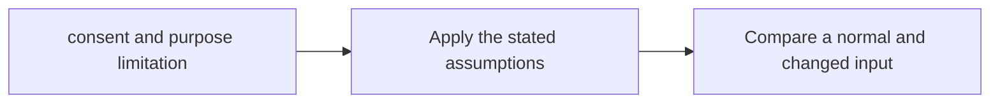

# A17.09 · consent and purpose limitation

[A17.08](A17.08.md) · Core · [A17.10](A17.10.md)

## Problem

Data collected for support is reused for another purpose.

## Mechanism

Record purposes and applicable lawful bases. Evaluate compatibility or identify another lawful route before changing processing. Fixture uses a strict purpose allowlist.



## Worked example

Consent covers support only. Proposed analytics is denied by the allowlist.

Read the [executable calculation](../examples/A17.09.py) after predicting both outcomes.

```sh
uv run --locked python "01-architecture-A01-to-A20/A17-regulated-ai-compliance-governance/examples/A17.09.py"
uv run --locked python "01-architecture-A01-to-A20/A17-regulated-ai-compliance-governance/examples/A17.09.py" --break
```

Expected outputs are `False` and `True` respectively. Record the changed input, formula or invariant and restore the original control.

## Check your reasoning

1. What assumption is violated in the opening problem?
2. Compute the first result without running the file.
3. Identify the first observable difference in the alternate run.
4. State one change to the input that would exercise the boundary more sharply.
5. What must be reviewed before enabling secondary use?

<details>
<summary>Feedback</summary>

Compare the opening failure with the mechanism above. The observed results are `False` and `True`. Check the derivation against the worked example. For your additional boundary case, write the expected behavior before executing it. For the transfer question, name the policy, invariant or measurable assumption the decision depends on and identify evidence that would falsify it.

</details>

Compare the first decisive intermediate observation before changing the fixture. Use [L2](../labs/L2.md) for phase-level practice.

## Primary source

- [Reference for consent and purpose limitation](https://eur-lex.europa.eu/eli/reg/2016/679/oj/eng/)
