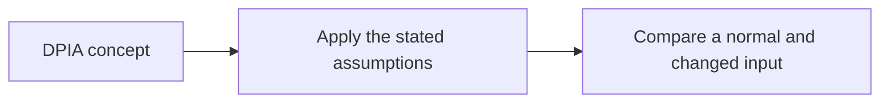

# A17.20 · DPIA concept

[A17.19](A17.19.md) · Principal · [A17.21](A17.21.md)

## Problem

A DPIA is presumed necessary for every project or never required.

## Mechanism

GDPR Article 35 describes DPIAs for processing likely to result in high risk, with examples and roles. Document findings, safeguards and residual risk through the responsible stakeholders.



## Worked example

Three fixture risks have owners, mitigations exist for two, leaving one unresolved.

Read the [executable calculation](../examples/A17.20.py) after predicting both outcomes.

```sh
uv run --locked python "01-architecture-A01-to-A20/A17-regulated-ai-compliance-governance/examples/A17.20.py"
uv run --locked python "01-architecture-A01-to-A20/A17-regulated-ai-compliance-governance/examples/A17.20.py" --break
```

Expected outputs are `1` and `0` respectively. Record the changed input, formula or invariant and restore the original control.

## Check your reasoning

1. What assumption is violated in the opening problem?
2. Compute the first result without running the file.
3. Identify the first observable difference in the alternate run.
4. State one change to the input that would exercise the boundary more sharply.
5. Which residual risks require escalation before launch?

<details>
<summary>Feedback</summary>

Compare the opening failure with the mechanism above. The observed results are `1` and `0`. Check the derivation against the worked example. For your additional boundary case, write the expected behavior before executing it. For the transfer question, name the policy, invariant or measurable assumption the decision depends on and identify evidence that would falsify it.

</details>

Compare the first decisive intermediate observation before changing the fixture. Use [L3](../labs/L3.md) for phase-level practice.

## Primary source

- [Reference for DPIA concept](https://eur-lex.europa.eu/eli/reg/2016/679/oj/eng/)
