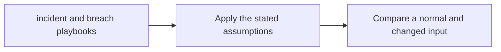

# A17.21 · incident and breach playbooks

[A17.20](A17.20.md) · Principal · [A17.22](A17.22.md)

## Problem

A breach response conflates detection and awareness.

## Mechanism

Record timeline and assess obligations under GDPR Articles 33–34. Article 33 generally requires supervisory notification without undue delay and, where feasible, within 72 hours after awareness unless unlikely to risk rights and freedoms.



## Worked example

A fictional notification at hour 60 is inside the 72-hour reference window; a 75-hour timestamp is beyond it.

Read the [executable calculation](../examples/A17.21.py) after predicting both outcomes.

```sh
uv run --locked python "01-architecture-A01-to-A20/A17-regulated-ai-compliance-governance/examples/A17.21.py"
uv run --locked python "01-architecture-A01-to-A20/A17-regulated-ai-compliance-governance/examples/A17.21.py" --break
```

Expected outputs are `True` and `False` respectively. Record the changed input, formula or invariant and restore the original control.

## Check your reasoning

1. What assumption is violated in the opening problem?
2. Compute the first result without running the file.
3. Identify the first observable difference in the alternate run.
4. State one change to the input that would exercise the boundary more sharply.
5. What additional decision determines whether individuals must be informed?

<details>
<summary>Feedback</summary>

Compare the opening failure with the mechanism above. The observed results are `True` and `False`. Check the derivation against the worked example. For your additional boundary case, write the expected behavior before executing it. For the transfer question, name the policy, invariant or measurable assumption the decision depends on and identify evidence that would falsify it.

</details>

Compare the first decisive intermediate observation before changing the fixture. Use [L4](../labs/L4.md) for phase-level practice.

## Primary source

- [Reference for incident and breach playbooks](https://eur-lex.europa.eu/eli/reg/2016/679/oj/eng/)
