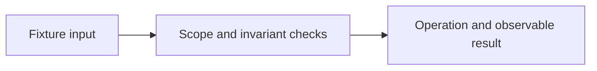

# A17 · Regulated AI requirements simulator

[Phase index](../../README.md)

Detect absent evidence and send a fictional administrative draft into human review. The fixture has no patient records, advice, diagnosis or treatment action.

## Architecture

## Acceptance evidence

- [L1](../../labs/L1.md). Record the state and why review and evidence are distinct.

Run the verification commands from the linked labs. Inspect the [guided source](guided.py) after predicting the outcome.
