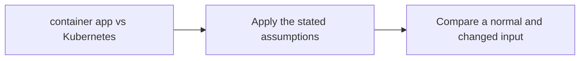

# A18.02 · container app vs Kubernetes

[A18.01](A18.01.md) · Foundation · [A18.03](A18.03.md)

## Problem

A team chooses Kubernetes for one stateless service without an operational need.

## Mechanism

Compare managed Container Apps and AKS by control-plane ownership, scaling, networking and platform capabilities. A required capability can eliminate a simpler option.



## Worked example

Required fixture features are revisions and custom scheduling. App platform has one; orchestrated platform has both.

Read the [executable calculation](../examples/A18.02.py) after predicting both outcomes.

```sh
uv run --locked python "01-architecture-A01-to-A20/A18-microsoft-foundry-enterprise-ai/examples/A18.02.py"
uv run --locked python "01-architecture-A01-to-A20/A18-microsoft-foundry-enterprise-ai/examples/A18.02.py" --break
```

Expected outputs are `0` and `1` respectively. Record the changed input, formula or invariant and restore the original control.

## Check your reasoning

1. What assumption is violated in the opening problem?
2. Compute the first result without running the file.
3. Identify the first observable difference in the alternate run.
4. State one change to the input that would exercise the boundary more sharply.
5. Where will the team incur operational responsibility?

<details>
<summary>Feedback</summary>

Compare the opening failure with the mechanism above. The observed results are `0` and `1`. Check the derivation against the worked example. For your additional boundary case, write the expected behavior before executing it. For the transfer question, name the policy, invariant or measurable assumption the decision depends on and identify evidence that would falsify it.

</details>

Compare the first decisive intermediate observation before changing the fixture. Use [L1](../labs/L1.md) for phase-level practice.

## Primary source

- [Reference for container app vs Kubernetes](https://learn.microsoft.com/en-us/azure/container-apps/compare-options)
