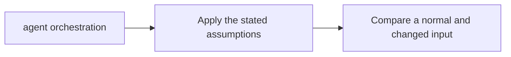

# A18.04 · agent orchestration

[A18.03](A18.03.md) · Foundation · [A18.05](A18.05.md)

## Problem

A platform can host an agent but the workflow needs approval before effect.

## Mechanism

Keep state and effect authorization explicit around tool calls. Evaluate platform runtime, versioning, observability and identity support per agent and deployment type.



## Worked example

Four transitions include one approval edge. A route skipping it records zero valid approvals.

Read the [executable calculation](../examples/A18.04.py) after predicting both outcomes.

```sh
uv run --locked python "01-architecture-A01-to-A20/A18-microsoft-foundry-enterprise-ai/examples/A18.04.py"
uv run --locked python "01-architecture-A01-to-A20/A18-microsoft-foundry-enterprise-ai/examples/A18.04.py" --break
```

Expected outputs are `1` and `0` respectively. Record the changed input, formula or invariant and restore the original control.

## Check your reasoning

1. What assumption is violated in the opening problem?
2. Compute the first result without running the file.
3. Identify the first observable difference in the alternate run.
4. State one change to the input that would exercise the boundary more sharply.
5. Who controls the workflow state when a hosted process restarts?

<details>
<summary>Feedback</summary>

Compare the opening failure with the mechanism above. The observed results are `1` and `0`. Check the derivation against the worked example. For your additional boundary case, write the expected behavior before executing it. For the transfer question, name the policy, invariant or measurable assumption the decision depends on and identify evidence that would falsify it.

</details>

Compare the first decisive intermediate observation before changing the fixture. Use [L1](../labs/L1.md) for phase-level practice.

## Primary source

- [Reference for agent orchestration](https://learn.microsoft.com/en-us/azure/foundry/agents/overview)
