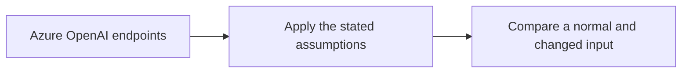

# A18.08 · Azure OpenAI endpoints

[A18.07](A18.07.md) · Core · [A18.09](A18.09.md)

## Problem

A workload is moved between Azure OpenAI and Foundry but retains mismatched configuration.

## Mechanism

Check endpoint pattern, API surface, authentication scope and deployment name for the service being called. Record version and compatibility in integration tests.



## Worked example

Endpoint, audience and named deployment must match. One mismatch fails the fixture.

Read the [executable calculation](../examples/A18.08.py) after predicting both outcomes.

```sh
uv run --locked python "01-architecture-A01-to-A20/A18-microsoft-foundry-enterprise-ai/examples/A18.08.py"
uv run --locked python "01-architecture-A01-to-A20/A18-microsoft-foundry-enterprise-ai/examples/A18.08.py" --break
```

Expected outputs are `False` and `True` respectively. Record the changed input, formula or invariant and restore the original control.

## Check your reasoning

1. What assumption is violated in the opening problem?
2. Compute the first result without running the file.
3. Identify the first observable difference in the alternate run.
4. State one change to the input that would exercise the boundary more sharply.
5. Which discovery document proves endpoint and identity settings?

<details>
<summary>Feedback</summary>

Compare the opening failure with the mechanism above. The observed results are `False` and `True`. Check the derivation against the worked example. For your additional boundary case, write the expected behavior before executing it. For the transfer question, name the policy, invariant or measurable assumption the decision depends on and identify evidence that would falsify it.

</details>

Compare the first decisive intermediate observation before changing the fixture. Use [L2](../labs/L2.md) for phase-level practice.

## Primary source

- [Reference for Azure OpenAI endpoints](https://learn.microsoft.com/en-us/azure/foundry/what-is-foundry)
