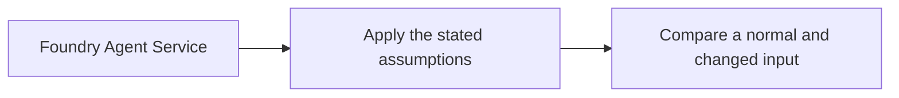

# A18.09 · Foundry Agent Service

[A18.08](A18.08.md) · Core · [A18.10](A18.10.md)

## Problem

A team expects hosted tools and persistence to apply equally to every deployment type.

## Mechanism

Choose agent type and runtime by tool support, state management, security and versioning. Check feature availability per deployment and service region.



## Worked example

Chosen route needs hosting and policy integration. One candidate supplies only hosting and fails requirements.

Read the [executable calculation](../examples/A18.09.py) after predicting both outcomes.

```sh
uv run --locked python "01-architecture-A01-to-A20/A18-microsoft-foundry-enterprise-ai/examples/A18.09.py"
uv run --locked python "01-architecture-A01-to-A20/A18-microsoft-foundry-enterprise-ai/examples/A18.09.py" --break
```

Expected outputs are `False` and `True` respectively. Record the changed input, formula or invariant and restore the original control.

## Check your reasoning

1. What assumption is violated in the opening problem?
2. Compute the first result without running the file.
3. Identify the first observable difference in the alternate run.
4. State one change to the input that would exercise the boundary more sharply.
5. Which controls must be maintained in application code?

<details>
<summary>Feedback</summary>

Compare the opening failure with the mechanism above. The observed results are `False` and `True`. Check the derivation against the worked example. For your additional boundary case, write the expected behavior before executing it. For the transfer question, name the policy, invariant or measurable assumption the decision depends on and identify evidence that would falsify it.

</details>

Compare the first decisive intermediate observation before changing the fixture. Use [L2](../labs/L2.md) for phase-level practice.

## Primary source

- [Reference for Foundry Agent Service](https://learn.microsoft.com/en-us/azure/foundry/agents/overview)
