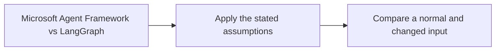

# A18.10 · Microsoft Agent Framework vs LangGraph

[A18.09](A18.09.md) · Core · [A18.11](A18.11.md)

## Problem

An orchestration comparison lists features but ignores failure semantics.

## Mechanism

Compare Microsoft Agent Framework and LangGraph using state model, checkpoint recovery, human handoff and test seams. Start with a framework-neutral workflow contract.



## Worked example

Two candidate fixtures support checkpointing, only one also supports a verified resume path.

Read the [executable calculation](../examples/A18.10.py) after predicting both outcomes.

```sh
uv run --locked python "01-architecture-A01-to-A20/A18-microsoft-foundry-enterprise-ai/examples/A18.10.py"
uv run --locked python "01-architecture-A01-to-A20/A18-microsoft-foundry-enterprise-ai/examples/A18.10.py" --break
```

Expected outputs are `1` and `2` respectively. Record the changed input, formula or invariant and restore the original control.

## Check your reasoning

1. What assumption is violated in the opening problem?
2. Compute the first result without running the file.
3. Identify the first observable difference in the alternate run.
4. State one change to the input that would exercise the boundary more sharply.
5. What behavior belongs in portability tests?

<details>
<summary>Feedback</summary>

Compare the opening failure with the mechanism above. The observed results are `1` and `2`. Check the derivation against the worked example. For your additional boundary case, write the expected behavior before executing it. For the transfer question, name the policy, invariant or measurable assumption the decision depends on and identify evidence that would falsify it.

</details>

Compare the first decisive intermediate observation before changing the fixture. Use [L2](../labs/L2.md) for phase-level practice.

## Primary source

- [Reference for Microsoft Agent Framework vs LangGraph](https://learn.microsoft.com/en-us/agent-framework/overview/agent-framework-overview)
