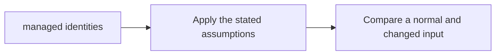

# A18.13 · managed identities

[A18.12](A18.12.md) · Core · [A18.14](A18.14.md)

## Problem

A managed identity was added but storage access still fails.

## Mechanism

Assign a system- or user-assigned identity and grant an appropriate role at target scope. Identity lifecycle and access assignment are separate.



## Worked example

Identity exists and token is valid, but missing data role blocks access.

Read the [executable calculation](../examples/A18.13.py) after predicting both outcomes.

```sh
uv run --locked python "01-architecture-A01-to-A20/A18-microsoft-foundry-enterprise-ai/examples/A18.13.py"
uv run --locked python "01-architecture-A01-to-A20/A18-microsoft-foundry-enterprise-ai/examples/A18.13.py" --break
```

Expected outputs are `False` and `True` respectively. Record the changed input, formula or invariant and restore the original control.

## Check your reasoning

1. What assumption is violated in the opening problem?
2. Compute the first result without running the file.
3. Identify the first observable difference in the alternate run.
4. State one change to the input that would exercise the boundary more sharply.
5. When would a user-assigned identity be preferable?

<details>
<summary>Feedback</summary>

Compare the opening failure with the mechanism above. The observed results are `False` and `True`. Check the derivation against the worked example. For your additional boundary case, write the expected behavior before executing it. For the transfer question, name the policy, invariant or measurable assumption the decision depends on and identify evidence that would falsify it.

</details>

Compare the first decisive intermediate observation before changing the fixture. Use [L2](../labs/L2.md) for phase-level practice.

## Primary source

- [Reference for managed identities](https://learn.microsoft.com/en-us/entra/identity/managed-identities-azure-resources/overview)
