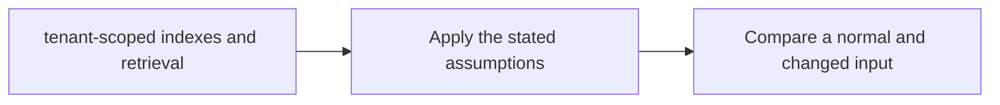

# A18.16 · tenant-scoped indexes and retrieval

[A18.15](A18.15.md) · Core · [A18.17](A18.17.md)

## Problem

Search indexes have tenant names but a shared service key is overprivileged.

## Mechanism

Choose shared index, index per tenant or service per tenant after assessing isolation, cost and limits. Enforce identity-to-scope all the way to the candidate set.



## Worked example

Tenant allowlist maps A to idx-a. Request for idx-b must fail.

Read the [executable calculation](../examples/A18.16.py) after predicting both outcomes.

```sh
uv run --locked python "01-architecture-A01-to-A20/A18-microsoft-foundry-enterprise-ai/examples/A18.16.py"
uv run --locked python "01-architecture-A01-to-A20/A18-microsoft-foundry-enterprise-ai/examples/A18.16.py" --break
```

Expected outputs are `False` and `True` respectively. Record the changed input, formula or invariant and restore the original control.

## Check your reasoning

1. What assumption is violated in the opening problem?
2. Compute the first result without running the file.
3. Identify the first observable difference in the alternate run.
4. State one change to the input that would exercise the boundary more sharply.
5. Where could a result cache bypass isolation?

<details>
<summary>Feedback</summary>

Compare the opening failure with the mechanism above. The observed results are `False` and `True`. Check the derivation against the worked example. For your additional boundary case, write the expected behavior before executing it. For the transfer question, name the policy, invariant or measurable assumption the decision depends on and identify evidence that would falsify it.

</details>

Compare the first decisive intermediate observation before changing the fixture. Use [L3](../labs/L3.md) for phase-level practice.

## Primary source

- [Reference for tenant-scoped indexes and retrieval](https://learn.microsoft.com/en-us/azure/search/search-modeling-multitenant-saas-applications)
