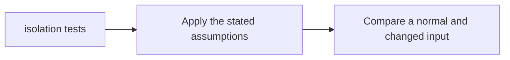

# A18.20 · isolation tests

[A18.19](A18.19.md) · Principal · [A18.21](A18.21.md)

## Problem

Isolation is judged only with the tenant's successful request.

## Mechanism

Use matched fixtures from multiple tenants, rotate scopes and assert foreign content and writes are absent. Cover index, cache and tool boundaries.



## Worked example

Allowed=2, denied=2, leakage=0 is a strong fixture. Counting only successes misses denial coverage.

Read the [executable calculation](../examples/A18.20.py) after predicting both outcomes.

```sh
uv run --locked python "01-architecture-A01-to-A20/A18-microsoft-foundry-enterprise-ai/examples/A18.20.py"
uv run --locked python "01-architecture-A01-to-A20/A18-microsoft-foundry-enterprise-ai/examples/A18.20.py" --break
```

Expected outputs are `(2, 2, 0)` and `(2, 0, 0)` respectively. Record the changed input, formula or invariant and restore the original control.

## Check your reasoning

1. What assumption is violated in the opening problem?
2. Compute the first result without running the file.
3. Identify the first observable difference in the alternate run.
4. State one change to the input that would exercise the boundary more sharply.
5. Which control should be evaluated during a dependency outage?

<details>
<summary>Feedback</summary>

Compare the opening failure with the mechanism above. The observed results are `(2, 2, 0)` and `(2, 0, 0)`. Check the derivation against the worked example. For your additional boundary case, write the expected behavior before executing it. For the transfer question, name the policy, invariant or measurable assumption the decision depends on and identify evidence that would falsify it.

</details>

Compare the first decisive intermediate observation before changing the fixture. Use [L3](../labs/L3.md) for phase-level practice.

## Primary source

- [Reference for isolation tests](https://learn.microsoft.com/en-us/azure/search/search-modeling-multitenant-saas-applications)
