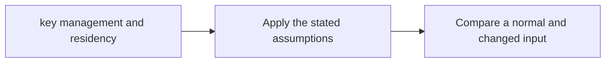

# A18.21 · key management and residency

[A18.20](A18.20.md) · Principal · [A18.22](A18.22.md)

## Problem

All resources share one key and backup region.

## Mechanism

Map permissions, key rotation and data flows for model, index, telemetry and backup services. Verify functionality and contractual residency for chosen offerings.



## Worked example

A configured two-region policy covers retail and backup fixtures but a third telemetry location is outside scope.

Read the [executable calculation](../examples/A18.21.py) after predicting both outcomes.

```sh
uv run --locked python "01-architecture-A01-to-A20/A18-microsoft-foundry-enterprise-ai/examples/A18.21.py"
uv run --locked python "01-architecture-A01-to-A20/A18-microsoft-foundry-enterprise-ai/examples/A18.21.py" --break
```

Expected outputs are `1` and `0` respectively. Record the changed input, formula or invariant and restore the original control.

## Check your reasoning

1. What assumption is violated in the opening problem?
2. Compute the first result without running the file.
3. Identify the first observable difference in the alternate run.
4. State one change to the input that would exercise the boundary more sharply.
5. Which logs and diagnostic exports need their own inventory?

<details>
<summary>Feedback</summary>

Compare the opening failure with the mechanism above. The observed results are `1` and `0`. Check the derivation against the worked example. For your additional boundary case, write the expected behavior before executing it. For the transfer question, name the policy, invariant or measurable assumption the decision depends on and identify evidence that would falsify it.

</details>

Compare the first decisive intermediate observation before changing the fixture. Use [L4](../labs/L4.md) for phase-level practice.

## Primary source

- [Reference for key management and residency](https://learn.microsoft.com/en-us/azure/private-link/private-endpoint-overview)
