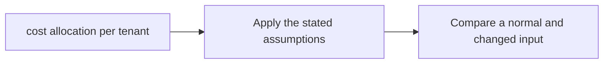

# A18.22 · cost allocation per tenant

[A18.21](A18.21.md) · Principal · [A18.23](A18.23.md)

## Problem

Shared capacity cost is assigned to the largest tenant by intuition.

## Mechanism

Choose metered allocations with a stated residual shared-cost rule. Compare cost attribution coverage to the total billed period.



## Worked example

Tenant usage 1:3 allocates a 40-unit variable pool as 10 and 30.

Read the [executable calculation](../examples/A18.22.py) after predicting both outcomes.

```sh
uv run --locked python "01-architecture-A01-to-A20/A18-microsoft-foundry-enterprise-ai/examples/A18.22.py"
uv run --locked python "01-architecture-A01-to-A20/A18-microsoft-foundry-enterprise-ai/examples/A18.22.py" --break
```

Expected outputs are `(10, 30)` and `(20, 20)` respectively. Record the changed input, formula or invariant and restore the original control.

## Check your reasoning

1. What assumption is violated in the opening problem?
2. Compute the first result without running the file.
3. Identify the first observable difference in the alternate run.
4. State one change to the input that would exercise the boundary more sharply.
5. How should unused reserved capacity be attributed?

<details>
<summary>Feedback</summary>

Compare the opening failure with the mechanism above. The observed results are `(10, 30)` and `(20, 20)`. Check the derivation against the worked example. For your additional boundary case, write the expected behavior before executing it. For the transfer question, name the policy, invariant or measurable assumption the decision depends on and identify evidence that would falsify it.

</details>

Compare the first decisive intermediate observation before changing the fixture. Use [L4](../labs/L4.md) for phase-level practice.

## Primary source

- [Reference for cost allocation per tenant](https://azure.microsoft.com/en-us/pricing/details/foundry-agent-service/)
