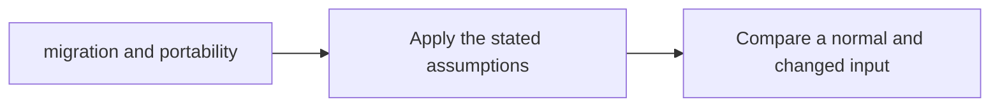

# A18.25 · migration and portability

[A18.24](A18.24.md) · Principal · [A18.26](A18.26.md)

## Problem

A replacement provider stores incompatible prompt artifacts.

## Mechanism

Keep transport and vendor-specific configuration behind an adapter. Preserve normalized release, tenant and evaluation evidence, then run contract tests at migration.



## Worked example

Both candidate adapters return status and usage; one loses source version and fails the required fields test.

Read the [executable calculation](../examples/A18.25.py) after predicting both outcomes.

```sh
uv run --locked python "01-architecture-A01-to-A20/A18-microsoft-foundry-enterprise-ai/examples/A18.25.py"
uv run --locked python "01-architecture-A01-to-A20/A18-microsoft-foundry-enterprise-ai/examples/A18.25.py" --break
```

Expected outputs are `False` and `True` respectively. Record the changed input, formula or invariant and restore the original control.

## Check your reasoning

1. What assumption is violated in the opening problem?
2. Compute the first result without running the file.
3. Identify the first observable difference in the alternate run.
4. State one change to the input that would exercise the boundary more sharply.
5. How do you distinguish behavior compatibility from wire compatibility?

<details>
<summary>Feedback</summary>

Compare the opening failure with the mechanism above. The observed results are `False` and `True`. Check the derivation against the worked example. For your additional boundary case, write the expected behavior before executing it. For the transfer question, name the policy, invariant or measurable assumption the decision depends on and identify evidence that would falsify it.

</details>

Compare the first decisive intermediate observation before changing the fixture. Use [L4](../labs/L4.md) for phase-level practice.

## Primary source

- [Reference for migration and portability](https://learn.microsoft.com/en-us/azure/architecture/guide/multitenant/considerations/tenancy-models)
