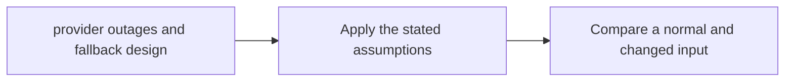

# A18.26 · provider outages and fallback design

[A18.25](A18.25.md) · Principal · [Exit gate](../README.md#practice-and-exit-gate)

## Problem

A fallback route moves data outside allowed location.

## Mechanism

Use a ranked allowlist constrained by region, tenancy and policy. Degrade safely when no eligible route is healthy.



## Worked example

Primary unavailable and fallback healthy but forbidden produces zero eligible routes.

Read the [executable calculation](../examples/A18.26.py) after predicting both outcomes.

```sh
uv run --locked python "01-architecture-A01-to-A20/A18-microsoft-foundry-enterprise-ai/examples/A18.26.py"
uv run --locked python "01-architecture-A01-to-A20/A18-microsoft-foundry-enterprise-ai/examples/A18.26.py" --break
```

Expected outputs are `0` and `1` respectively. Record the changed input, formula or invariant and restore the original control.

## Check your reasoning

1. What assumption is violated in the opening problem?
2. Compute the first result without running the file.
3. Identify the first observable difference in the alternate run.
4. State one change to the input that would exercise the boundary more sharply.
5. How do you verify restore and telemetry after failback?

<details>
<summary>Feedback</summary>

Compare the opening failure with the mechanism above. The observed results are `0` and `1`. Check the derivation against the worked example. For your additional boundary case, write the expected behavior before executing it. For the transfer question, name the policy, invariant or measurable assumption the decision depends on and identify evidence that would falsify it.

</details>

Compare the first decisive intermediate observation before changing the fixture. Use [L4](../labs/L4.md) for phase-level practice.

## Primary source

- [Reference for provider outages and fallback design](https://docs.aws.amazon.com/whitepapers/latest/disaster-recovery-workloads-on-aws/business-continuity-plan-bcp.html)
