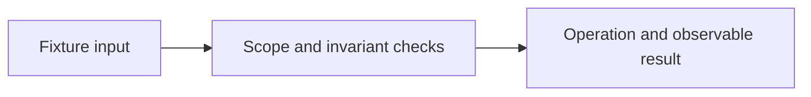

# A18 · Multi-tenant Foundry architecture mock

[Phase index](../../README.md)

Model identity-to-index scoping and ordered routes within allowed regions. This independent Python fixture exercises provider-neutral rules without deploying Azure resources.

## Architecture

## Acceptance evidence

- [L1](../../labs/L1.md). Record result IDs and each denied path.
- [L3](../../labs/L3.md). Record the route or safe deferral; explain what a live setup must verify.

Run the verification commands from the linked labs. Inspect the [guided source](guided.py) after predicting the outcome.
