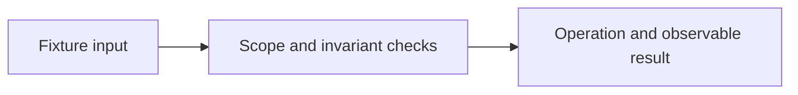

# A18 · Enterprise AI SaaS with identity and cost attribution

[Phase index](../../README.md)

Prototype a metered tenant service boundary with input/output tariff arithmetic, quotas, replay-safe request identity and rejection of mismatched principals. Rates are synthetic and operations stay in process.

## Architecture

## Acceptance evidence

- [L2](../../labs/L2.md). Record integer tariff units and the quota outcome. These are fixture tariff units.
- [L4](../../labs/L4.md). Record replay, denial and both tenant totals.

Run the verification commands from the linked labs. Inspect the [independent source](independent.py) after predicting the outcome.

Attempt an independent implementation and preserve normal and failure results before consulting the reference. Repeat with a counterexample from a different input family.
