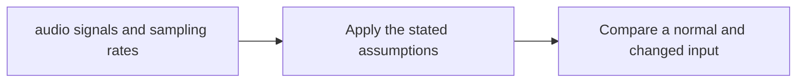

# A19.01 · audio signals and sampling rates

[Phase index](../README.md) · Foundation · [A19.02](A19.02.md)

## Problem

A recorder writes samples too slowly to preserve the signal band.

## Mechanism

Sampling represents a continuous signal at discrete times. A bandlimited signal below half the sample rate can be recovered in the ideal model; real systems filter before sampling.



## Worked example

A 16 kHz sampling rate has Nyquist frequency 8 kHz. A 9 kHz tone exceeds it.

Read the [executable calculation](../examples/A19.01.py) after predicting both outcomes.

```sh
uv run --locked python "01-architecture-A01-to-A20/A19-voice-multimodal-edge-embedded-ai/examples/A19.01.py"
uv run --locked python "01-architecture-A01-to-A20/A19-voice-multimodal-edge-embedded-ai/examples/A19.01.py" --break
```

Expected outputs are `8000` and `16000` respectively. Record the changed input, formula or invariant and restore the original control.

## Check your reasoning

1. What assumption is violated in the opening problem?
2. Compute the first result without running the file.
3. Identify the first observable difference in the alternate run.
4. State one change to the input that would exercise the boundary more sharply.
5. What happens if the input contains energy above the allowed band?

<details>
<summary>Feedback</summary>

Compare the opening failure with the mechanism above. The observed results are `8000` and `16000`. Check the derivation against the worked example. For your additional boundary case, write the expected behavior before executing it. For the transfer question, name the policy, invariant or measurable assumption the decision depends on and identify evidence that would falsify it.

</details>

Compare the first decisive intermediate observation before changing the fixture. Use [L1](../labs/L1.md) for phase-level practice.

## Primary source

- [Reference for audio signals and sampling rates](https://docs.scipy.org/doc/scipy/reference/signal.html)
