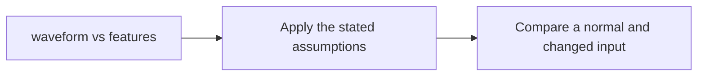

# A19.02 · waveform vs features

[A19.01](A19.01.md) · Foundation · [A19.03](A19.03.md)

## Problem

An inference pipeline confuses frames and sample counts.

## Mechanism

A waveform stores amplitude over time; features summarize short frames using energy, frequency content or learned transforms. Specify window, hop and channel conventions.



## Worked example

At 16 kHz a 25 ms window contains 400 samples. A 10 ms hop contains 160.

Read the [executable calculation](../examples/A19.02.py) after predicting both outcomes.

```sh
uv run --locked python "01-architecture-A01-to-A20/A19-voice-multimodal-edge-embedded-ai/examples/A19.02.py"
uv run --locked python "01-architecture-A01-to-A20/A19-voice-multimodal-edge-embedded-ai/examples/A19.02.py" --break
```

Expected outputs are `(400, 160)` and `(25, 10)` respectively. Record the changed input, formula or invariant and restore the original control.

## Check your reasoning

1. What assumption is violated in the opening problem?
2. Compute the first result without running the file.
3. Identify the first observable difference in the alternate run.
4. State one change to the input that would exercise the boundary more sharply.
5. How does framing affect time resolution and latency?

<details>
<summary>Feedback</summary>

Compare the opening failure with the mechanism above. The observed results are `(400, 160)` and `(25, 10)`. Check the derivation against the worked example. For your additional boundary case, write the expected behavior before executing it. For the transfer question, name the policy, invariant or measurable assumption the decision depends on and identify evidence that would falsify it.

</details>

Compare the first decisive intermediate observation before changing the fixture. Use [L1](../labs/L1.md) for phase-level practice.

## Primary source

- [Reference for waveform vs features](https://docs.scipy.org/doc/scipy/reference/signal.html)
