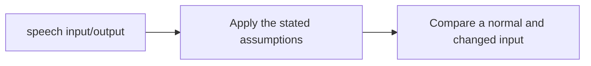

# A19.03 · speech input/output

[A19.02](A19.02.md) · Foundation · [A19.04](A19.04.md)

## Problem

Audio directions have different timing and formats.

## Mechanism

Capture, resample and frame input before recognition. Synthesize and buffer output at the playback contract. Exchange clocks and formats explicitly.



## Worked example

Mono 16-bit PCM at 16 kHz uses 32,000 bytes/s before headers. Stereo doubles it.

Read the [executable calculation](../examples/A19.03.py) after predicting both outcomes.

```sh
uv run --locked python "01-architecture-A01-to-A20/A19-voice-multimodal-edge-embedded-ai/examples/A19.03.py"
uv run --locked python "01-architecture-A01-to-A20/A19-voice-multimodal-edge-embedded-ai/examples/A19.03.py" --break
```

Expected outputs are `32000` and `64000` respectively. Record the changed input, formula or invariant and restore the original control.

## Check your reasoning

1. What assumption is violated in the opening problem?
2. Compute the first result without running the file.
3. Identify the first observable difference in the alternate run.
4. State one change to the input that would exercise the boundary more sharply.
5. What happens if the receiver interprets the wrong sample format?

<details>
<summary>Feedback</summary>

Compare the opening failure with the mechanism above. The observed results are `32000` and `64000`. Check the derivation against the worked example. For your additional boundary case, write the expected behavior before executing it. For the transfer question, name the policy, invariant or measurable assumption the decision depends on and identify evidence that would falsify it.

</details>

Compare the first decisive intermediate observation before changing the fixture. Use [L1](../labs/L1.md) for phase-level practice.

## Primary source

- [Reference for speech input/output](https://learn.microsoft.com/en-us/azure/ai-services/speech-service/overview)
