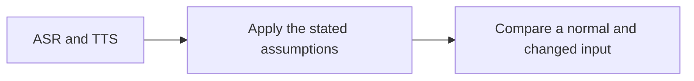

# A19.04 · ASR and TTS

[A19.03](A19.03.md) · Foundation · [A19.05](A19.05.md)

## Problem

Recognition accuracy is confused with output voice quality.

## Mechanism

ASR maps audio to text estimates and TTS maps text to audio. Use separate evaluations such as word errors for ASR and listening or task measures for TTS.



## Worked example

One substitution, one insertion and one deletion in a ten-word reference gives WER 0.3.

Read the [executable calculation](../examples/A19.04.py) after predicting both outcomes.

```sh
uv run --locked python "01-architecture-A01-to-A20/A19-voice-multimodal-edge-embedded-ai/examples/A19.04.py"
uv run --locked python "01-architecture-A01-to-A20/A19-voice-multimodal-edge-embedded-ai/examples/A19.04.py" --break
```

Expected outputs are `0.3` and `0.1` respectively. Record the changed input, formula or invariant and restore the original control.

## Check your reasoning

1. What assumption is violated in the opening problem?
2. Compute the first result without running the file.
3. Identify the first observable difference in the alternate run.
4. State one change to the input that would exercise the boundary more sharply.
5. Why can WER exceed 100 percent?

<details>
<summary>Feedback</summary>

Compare the opening failure with the mechanism above. The observed results are `0.3` and `0.1`. Check the derivation against the worked example. For your additional boundary case, write the expected behavior before executing it. For the transfer question, name the policy, invariant or measurable assumption the decision depends on and identify evidence that would falsify it.

</details>

Compare the first decisive intermediate observation before changing the fixture. Use [L1](../labs/L1.md) for phase-level practice.

## Primary source

- [Reference for ASR and TTS](https://learn.microsoft.com/en-us/azure/ai-services/speech-service/overview)
