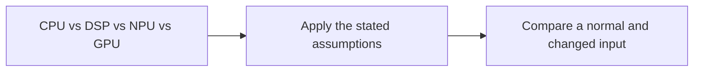

# A19.07 · CPU vs DSP vs NPU vs GPU

[A19.06](A19.06.md) · Foundation · [A19.08](A19.08.md)

## Problem

A model is described as accelerated without measuring copies.

## Mechanism

CPU suits general control work; DSPs often process signal kernels, and GPU/NPU benefits depend on supported operations and data movement. Measure whole-pipeline cost.



## Worked example

A modeled accelerator kernel takes 8 ms plus 6 ms transfer each way, total 20. A 15 ms CPU path wins.

Read the [executable calculation](../examples/A19.07.py) after predicting both outcomes.

```sh
uv run --locked python "01-architecture-A01-to-A20/A19-voice-multimodal-edge-embedded-ai/examples/A19.07.py"
uv run --locked python "01-architecture-A01-to-A20/A19-voice-multimodal-edge-embedded-ai/examples/A19.07.py" --break
```

Expected outputs are `15` and `8` respectively. Record the changed input, formula or invariant and restore the original control.

## Check your reasoning

1. What assumption is violated in the opening problem?
2. Compute the first result without running the file.
3. Identify the first observable difference in the alternate run.
4. State one change to the input that would exercise the boundary more sharply.
5. When does reuse amortize transfer cost?

<details>
<summary>Feedback</summary>

Compare the opening failure with the mechanism above. The observed results are `15` and `8`. Check the derivation against the worked example. For your additional boundary case, write the expected behavior before executing it. For the transfer question, name the policy, invariant or measurable assumption the decision depends on and identify evidence that would falsify it.

</details>

Compare the first decisive intermediate observation before changing the fixture. Use [L1](../labs/L1.md) for phase-level practice.

## Primary source

- [Reference for CPU vs DSP vs NPU vs GPU](https://onnxruntime.ai/docs/tutorials/mobile/)
