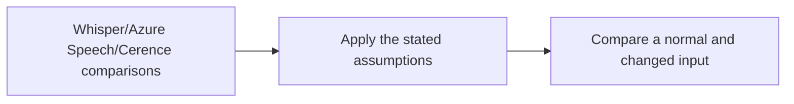

# A19.10 · Whisper/Azure Speech/Cerence comparisons

[A19.09](A19.09.md) · Core · [A19.11](A19.11.md)

## Problem

Providers are compared on marketing claims rather than the same corpus.

## Mechanism

Compare Whisper, Azure Speech and Cerence offerings by deployment target, language, licensing or commercial terms, latency and WER on identical labeled audio. Verify available features for the selected version.



## Worked example

Provider A makes 3 errors in 20 words and B makes 5, so fixture WER gap is 0.1.

Read the [executable calculation](../examples/A19.10.py) after predicting both outcomes.

```sh
uv run --locked python "01-architecture-A01-to-A20/A19-voice-multimodal-edge-embedded-ai/examples/A19.10.py"
uv run --locked python "01-architecture-A01-to-A20/A19-voice-multimodal-edge-embedded-ai/examples/A19.10.py" --break
```

Expected outputs are `0.1` and `2` respectively. Record the changed input, formula or invariant and restore the original control.

## Check your reasoning

1. What assumption is violated in the opening problem?
2. Compute the first result without running the file.
3. Identify the first observable difference in the alternate run.
4. State one change to the input that would exercise the boundary more sharply.
5. What hardware and audio conditions belong in the result?

<details>
<summary>Feedback</summary>

Compare the opening failure with the mechanism above. The observed results are `0.1` and `2`. Check the derivation against the worked example. For your additional boundary case, write the expected behavior before executing it. For the transfer question, name the policy, invariant or measurable assumption the decision depends on and identify evidence that would falsify it.

</details>

Compare the first decisive intermediate observation before changing the fixture. Use [L2](../labs/L2.md) for phase-level practice.

## Primary source

- [Reference for Whisper/Azure Speech/Cerence comparisons](https://github.com/openai/whisper)

- [Azure Speech service overview](https://learn.microsoft.com/en-us/azure/ai-services/speech-service/overview)
- [Cerence products and technology](https://www.cerence.com/platforms/cerence-assistant)
