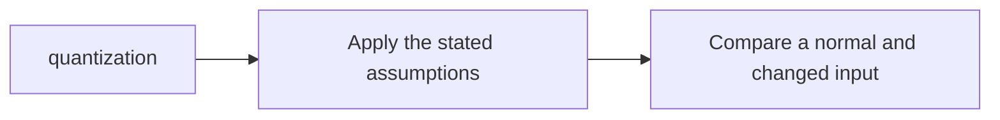

# A19.15 · quantization

[A19.14](A19.14.md) · Core · [A19.16](A19.16.md)

## Problem

A quantized model preserves size but degrades rare cases.

## Mechanism

Represent selected tensors using lower precision, often with scale and zero point. Measure rounding, clipping, kernel support and quality across slices.



## Worked example

1000 FP32 elements need 4000 B versus 1000 B for int8 payload, before scales and padding.

Read the [executable calculation](../examples/A19.15.py) after predicting both outcomes.

```sh
uv run --locked python "01-architecture-A01-to-A20/A19-voice-multimodal-edge-embedded-ai/examples/A19.15.py"
uv run --locked python "01-architecture-A01-to-A20/A19-voice-multimodal-edge-embedded-ai/examples/A19.15.py" --break
```

Expected outputs are `(4000, 1000)` and `(4000, 4000)` respectively. Record the changed input, formula or invariant and restore the original control.

## Check your reasoning

1. What assumption is violated in the opening problem?
2. Compute the first result without running the file.
3. Identify the first observable difference in the alternate run.
4. State one change to the input that would exercise the boundary more sharply.
5. Which structures make total artifact size differ from tensor payload?

<details>
<summary>Feedback</summary>

Compare the opening failure with the mechanism above. The observed results are `(4000, 1000)` and `(4000, 4000)`. Check the derivation against the worked example. For your additional boundary case, write the expected behavior before executing it. For the transfer question, name the policy, invariant or measurable assumption the decision depends on and identify evidence that would falsify it.

</details>

Compare the first decisive intermediate observation before changing the fixture. Use [L2](../labs/L2.md) for phase-level practice.

## Primary source

- [Reference for quantization](https://onnxruntime.ai/docs/performance/model-optimizations/quantization.html)
