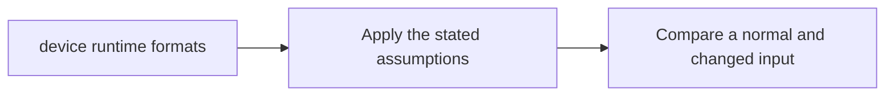

# A19.18 · device runtime formats

[A19.17](A19.17.md) · Core · [A19.19](A19.19.md)

## Problem

A runtime file loads but a required operator lacks an implementation.

## Mechanism

Record format, opset, execution provider and host capability. Verify output tolerances and unsupported-operator behavior on the real device.



## Worked example

Required ops matmul and resize, supplied matmul only: one is missing.

Read the [executable calculation](../examples/A19.18.py) after predicting both outcomes.

```sh
uv run --locked python "01-architecture-A01-to-A20/A19-voice-multimodal-edge-embedded-ai/examples/A19.18.py"
uv run --locked python "01-architecture-A01-to-A20/A19-voice-multimodal-edge-embedded-ai/examples/A19.18.py" --break
```

Expected outputs are `1` and `0` respectively. Record the changed input, formula or invariant and restore the original control.

## Check your reasoning

1. What assumption is violated in the opening problem?
2. Compute the first result without running the file.
3. Identify the first observable difference in the alternate run.
4. State one change to the input that would exercise the boundary more sharply.
5. How can the runtime silently fall back to a slower provider?

<details>
<summary>Feedback</summary>

Compare the opening failure with the mechanism above. The observed results are `1` and `0`. Check the derivation against the worked example. For your additional boundary case, write the expected behavior before executing it. For the transfer question, name the policy, invariant or measurable assumption the decision depends on and identify evidence that would falsify it.

</details>

Compare the first decisive intermediate observation before changing the fixture. Use [L3](../labs/L3.md) for phase-level practice.

## Primary source

- [Reference for device runtime formats](https://onnxruntime.ai/docs/tutorials/mobile/)
