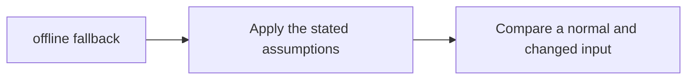

# A19.20 · offline fallback

[A19.19](A19.19.md) · Core · [A19.21](A19.21.md)

## Problem

An offline transcript triggers an action whose authorization is unavailable.

## Mechanism

Define an offline policy with a small local capability set and explicit deferral. Use safe defaults when authorization, time or telemetry dependencies are unavailable.



## Worked example

Offline intent status is allowed while remote-write is deferred.

Read the [executable calculation](../examples/A19.20.py) after predicting both outcomes.

```sh
uv run --locked python "01-architecture-A01-to-A20/A19-voice-multimodal-edge-embedded-ai/examples/A19.20.py"
uv run --locked python "01-architecture-A01-to-A20/A19-voice-multimodal-edge-embedded-ai/examples/A19.20.py" --break
```

Expected outputs are `False` and `True` respectively. Record the changed input, formula or invariant and restore the original control.

## Check your reasoning

1. What assumption is violated in the opening problem?
2. Compute the first result without running the file.
3. Identify the first observable difference in the alternate run.
4. State one change to the input that would exercise the boundary more sharply.
5. Which operation must remain unavailable without fresh remote policy?

<details>
<summary>Feedback</summary>

Compare the opening failure with the mechanism above. The observed results are `False` and `True`. Check the derivation against the worked example. For your additional boundary case, write the expected behavior before executing it. For the transfer question, name the policy, invariant or measurable assumption the decision depends on and identify evidence that would falsify it.

</details>

Compare the first decisive intermediate observation before changing the fixture. Use [L3](../labs/L3.md) for phase-level practice.

## Primary source

- [Reference for offline fallback](https://docs.aws.amazon.com/greengrass/v2/developerguide/how-it-works.html)
