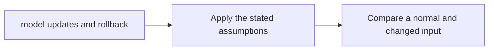

# A19.26 · model updates and rollback

[A19.25](A19.25.md) · Principal · [A19.27](A19.27.md)

## Problem

An interrupted device update replaces the only working model.

## Mechanism

Verify artifact identity and integrity, activate atomically, and preserve the previous working version. Account for compatibility and anti-rollback policy.



## Worked example

Invalid candidate v2 leaves v1 active; unconditional activation chooses v2.

Read the [executable calculation](../examples/A19.26.py) after predicting both outcomes.

```sh
uv run --locked python "01-architecture-A01-to-A20/A19-voice-multimodal-edge-embedded-ai/examples/A19.26.py"
uv run --locked python "01-architecture-A01-to-A20/A19-voice-multimodal-edge-embedded-ai/examples/A19.26.py" --break
```

Expected outputs are `'v1'` and `'v2'` respectively. Record the changed input, formula or invariant and restore the original control.

## Check your reasoning

1. What assumption is violated in the opening problem?
2. Compute the first result without running the file.
3. Identify the first observable difference in the alternate run.
4. State one change to the input that would exercise the boundary more sharply.
5. Which evidence triggers restoration after reboot?

<details>
<summary>Feedback</summary>

Compare the opening failure with the mechanism above. The observed results are `'v1'` and `'v2'`. Check the derivation against the worked example. For your additional boundary case, write the expected behavior before executing it. For the transfer question, name the policy, invariant or measurable assumption the decision depends on and identify evidence that would falsify it.

</details>

Compare the first decisive intermediate observation before changing the fixture. Use [L4](../labs/L4.md) for phase-level practice.

## Primary source

- [Reference for model updates and rollback](https://slsa.dev/spec/)
